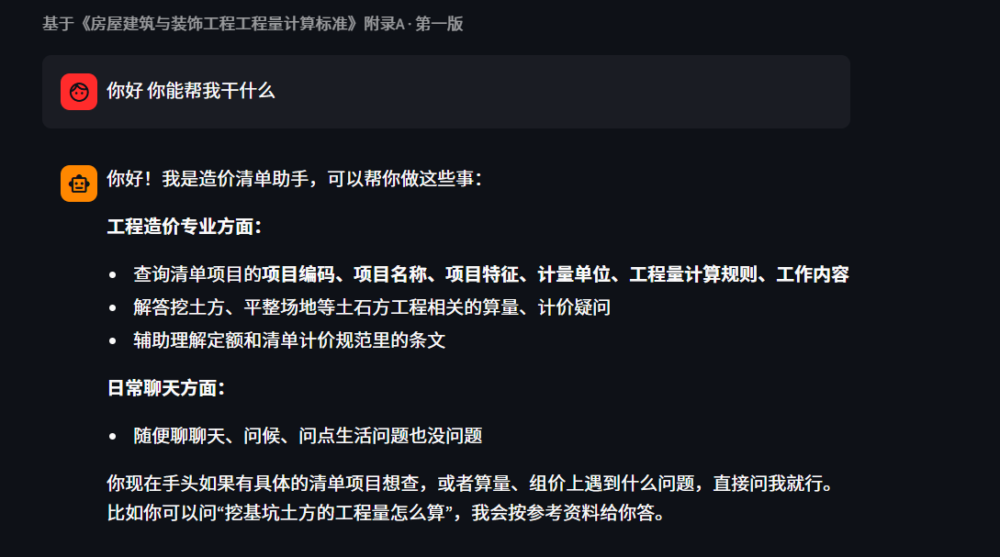
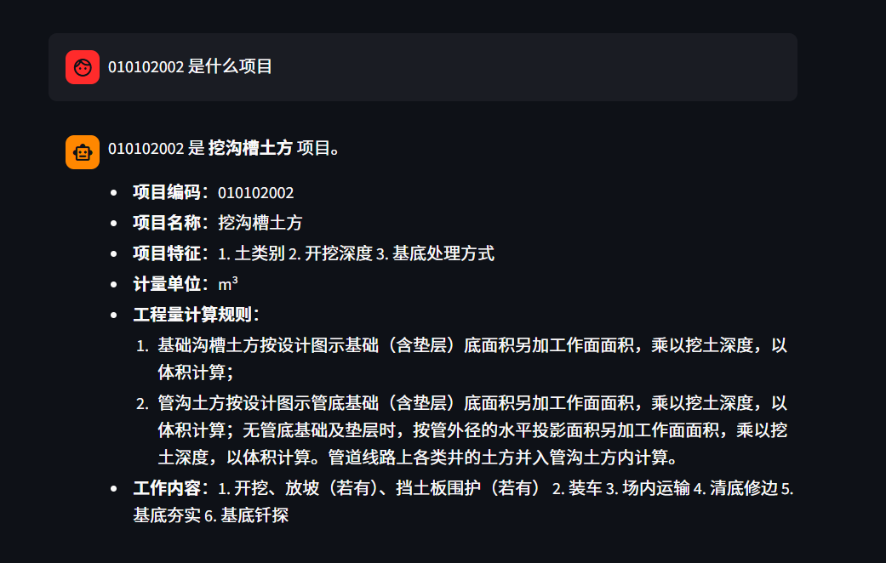

# 🏗️ 造价清单智能问答助手

基于 RAG 的造价清单智能问答系统，支持查询工程量计算规则、项目编码、工作内容等。

## 项目简介

造价人员查清单规范时，需要翻 PDF、找编码、核对计算规则。本项目把清单数据做成可检索的知识库，用自然语言提问，直接返回相关清单项及完整信息。

## 技术栈

- **RAG**：检索增强生成
- **向量库**：Milvus Lite
- **Embedding**：阿里云 text-embedding-v4（1024 维）
- **大模型**：DeepSeek
- **界面**：Streamlit

## 数据源

基于《房屋建筑与装饰工程工程量计算规范》（GB 50854—2013）附录A 土石方工程，共 **12 条**清单项。

> 注：该标准已被 GB/T 50854—2024 取代，第二版计划同步更新。

## 项目结构
├── 01_ZJ.py # 建库脚本：读 CSV → 向量化 → 插入 Milvus
├── 02_app.py # Streamlit 界面：检索 → 生成答案
├── DE_1.csv # 清单数据
├── requirements.txt # 依赖清单
└── README.md

```bash
# 1. 安装依赖
pip install -r requirements.txt

# 2. 配置 .env
DASHSCOPE_API_KEY=你的阿里云Key
DASHSCOPE_BASE_URL=你的百炼BaseURL
DEEPSEEK_API_KEY=你的DeepSeek Key
DEEPSEEK_BASE_URL=https://api.deepseek.com

# 3. 建库
python 01_ZJ.py

# 4. 启动界面
streamlit run 02_app.py

功能演示

